<div align="right">

[English](./README.md) · **简体中文**

</div>

# MCU-Agent

> **用 AI Agent 做真实单片机固件开发** —— 以 `arm-none-eabi-gcc + CMake + Ninja + OpenOCD` 打通
> 构建、烧录、调试与自我迭代，并在真机上完成验收。

<p>
  
  
  
  
  
</p>

前端和桌面端程序已经可以大幅度被 AI 取代。嵌入式看起来有壁垒——交叉编译、硬件点亮、实时约束；
但作为**固定的知识**，它其实也没有壁垒，一旦写成 Agent 能直接执行的作业规程，壁垒就不成立了。

本仓库是这件事的实证：**22 个完整单片机项目**，全部由 AI Agent 走通完整闭环——
搭骨架 → 实现 → 双构零警告 → 烧录 → 真机验证 → 回归脚本。

---

## 这个仓库解决什么问题

生成代码不难。难的是单片机目标**不是一个可以随便重启的容器**：

| 疑问 | 在哪里被回答 |
|---|---|
| ❓ 如何让 AI 自动编译、调试、下载和仿真，然后走通自我迭代流程？ | [开发环境](./document/support.md) · [`embedded-verification-acceptance`](https://github.com/zc110747/EmbedSkills) |
| ❓ 提示词如何写，才能让 AI 更好地规划单片机任务处理？ | [提示词四要素](#提示词四要素) · 各项目的 `prompter.md` |
| ❓ AI 完成的项目如何验收，遇到问题如何解决？ | [验收优先工作流](#验收优先工作流) · `tools/verify_*.py` |

---

## 目录

- [硬件平台](#硬件平台)
- [项目总览](#项目总览)
- [快速开始](#快速开始)
- [项目详情](#项目详情)
  - [STM32H743ZIT6](#stm32h743zit6-1)
  - [STM32F429IGT6](#stm32f429igt6-1)
  - [ESP32-S3](#esp32-s3-1)
  - [Renesas RA8D1](#renesas-ra8d1-1)
- [技能库](#技能库)
- [验收优先工作流](#验收优先工作流)
- [提示词四要素](#提示词四要素)
- [开发经验总结](#开发经验总结)
- [仓库结构](#仓库结构)
- [规划](#规划)
- [License](#license)

---

## 硬件平台

| 开发板 | MCU | 调试器 | 说明 |
|---|---|---|---|
| **鹿小班 H743 核心板** | STM32H743ZIT6（Cortex-M7 @480 MHz） | ST-Link / 自研 CMSIS-DAP | 主力平台，13 个项目 |
| **正点原子 阿波罗** | STM32F429IGT6（Cortex-M4 @180 MHz） | ST-Link | LAN8720A PHY、SDRAM、USB Host |
| **ESP32-S3-DevKitC-1** | ESP32-S3 N16R8 | 板载 USB-Serial/JTAG | Arduino CLI + ESP-IDF |
| **ESP32-S3-Touch-LCD-4.3B** | ESP32-S3 N16R8 | 板载 USB-Serial/JTAG | 微雪 800×480 RGB + 电容触摸 |
| **RA8D1 Vision Board** | R7FA8D1BH（Cortex-M85 @480 MHz） | ART-Link（CMSIS-DAP） | Renesas，pyOCD + OpenOCD |

---

## 项目总览

图例：✅ 已完成并通过真机验收 · 🚧 进行中

### STM32H743ZIT6

| # | 项目 | 技术栈 | 要点 |
|---|---|---|---|
| 001 | [USB 混合设备（CDC + MSC）](./001.stm32h743_tinyusb_cdc_msc/README.md) | TinyUSB | 一个设备两个类，端点复用 |
| 002 | [UVC 摄像头（OV5640）](./002.stm32h743_tinyusb_uvc_ov5640/README.md) | TinyUSB + DCMI | 多缓冲采集，经 USB ISO 提交 |
| 003 | [LVGL OLED（SD 卡中文字库）](./003.stm32h743_lvgl_oled/docs/README.md) | LVGL + FatFs | SD 卡字库加载，中文渲染 |
| 004 | [SD 卡图片轮播](./004.stm32h743_sd_oled_img/README.md) | FatFs + JPEG | 边解边显示，直写帧缓冲 |
| 005 | [人存在检测](./005.stm32h743_person_detect/README.md) | CMSIS-NN | OV5640 + int8 模型跑在 Cortex-M7 |
| 006 | [人脸检测与显示](./006.stm32h743_face_detect/README.md) | CMSIS-NN + PyTorch | 模型本地训练量化后部署上板 |
| 007 | [CMSIS-DAP 调试器](./007.stm32h743_cmsis_dap/README.md) | TinyUSB + SWD/JTAG | 把开发板变成真正的调试器 |
| 008 | [LVGL 智能手表套件](./008.stm32h743_lvgl_mos/README.md) | LVGL + NES | 时钟、相机、图片查看、文本阅读、NES 模拟器 |
| 009 | [Zephyr + LVGL](./009.stm32h743_zephyr/README.md) | Zephyr 3.7 + LVGL 8.4 | 设备树 overlay、FatFs、Zephyr shell |
| 010 | [QSPI 虚拟 U 盘 + 安全升级 Bootloader](./010.stm32h743_boot/README.md) | TinyUSB MSC + HMAC-SHA256 | QSPI FatFs、签名升级、固件跳转 |
| 011 | [emWin + FreeRTOS 信息面板](./011.stm32h743_freertos_emwin/README.md) | STemWin + FreeRTOS | ST7789 SPI6、GBK 点阵字库 |
| 012 | [USB CDC ↔ UART4 高可靠桥接](./012.stm32h743_usb_serial/README.md) | TinyUSB + DMA | 环形缓冲、硬件流控、无 RTOS |
| 013 | [软件 UART（GPIO + Timer + DMA）](./013.stm32h743_virtual_uart/README.md) | TIM + DMA + EXTI | 完全不用 USART 外设；3 小时长稳 |

### STM32F429IGT6

| # | 项目 | 技术栈 | 要点 |
|---|---|---|---|
| 101 | [局域网管理系统](./101.stm32f429_net/README.md) | lwIP + FreeRTOS | HTTP/HTTPS、串口 shell、telnet shell、SNMP 代理 |
| 102 | [USB Host + exFAT + LVGL + 触摸面板](./102.stm32f429_tinyusb_ui/README.md) | TinyUSB Host + LVGL | 真 exFAT（非 FAT32 伪装）、GT911 软件 I²C |

### ESP32-S3

| # | 项目 | 技术栈 | 要点 |
|---|---|---|---|
| 201 | [FreeRTOS 多任务设备监控器](./201.esp32s3_rtos/README.md) | Arduino + FreeRTOS | 4 任务 + 软件定时器，串口命令台 |
| 202 | [USB 远程硬件仿真器](./202.esp32s3_hw_detect/README.md) | ESP-IDF | UART / ADC / GPIO 经 WebSocket + MQTT，OTA |
| 203 | [CMSIS-DAP 无线调试探针](./203.esp32s3_wireless_debug/README.md) | TinyUSB HID | SWD + JTAG，8 MHz 时钟，Wi-Fi 兜底传输 |
| 204 | [触摸电子书 / 多功能设备](./204.esp32s3_touch_ebook/README.md) | ESP-IDF + LVGL 9 | 800×480 RGB 屏，10 个产品页，GBK 阅读器 |

### Renesas RA8D1

| # | 项目 | 技术栈 | 要点 |
|---|---|---|---|
| 301 | [RA8D1 Vision Board + LVGL](./301.ra8d1_lcd_lvgl/README.md) | RT-Thread Nano + LVGL 9.1 | GLCDC/MIPI-DSI 通路、RTC、启动动作条 |
| 302 | [RA8D1 NES 模拟器 + DRW2D + USB MSC](./302.ra8d1_lcd_nes/) | RT-Thread Nano + Dave2D | GPU 加速贴图、W25Q64 FatFs、USB MSC |

---

## 快速开始

### 1. 准备环境

对 AI Agent 最友好的工具链是 **CLI 交叉编译 + 硬件调试** 这条路，不需要 IDE：

```
arm-none-eabi-gcc + cmake + ninja + openocd + pyocd  →  加入系统环境变量
python                                                →  生成测试代码 / 执行修改 / 测试任务
vscode + Cortex-Debug                                 →  交互式在线仿真
```

完整安装说明与下载地址：**[document/support.md](./document/support.md)**

> ⚠️ 所有工具**必须加入系统环境变量**，能在裸命令行直接访问——Agent 就是这么调用它们的。
> ⚠️ ST-Link / J-Link / USB 转串口驱动需要自行安装。
> ⚠️ 使用 ST-Link 以外的硬件（J-Link、DAP-Link）需要修改 `.cfg` 文件。

把下面这段提示词丢给 Agent，即可一键搭好环境：

```text
项目添加嵌入式在线仿真调试安装环境，具体如下。

1. 工具内容 python、vscode(Cortex-Debug)、arm-none-eabi-gcc、cmake、ninja、openocd，且需要添加到系统环境中
2. 命令行测试直接指令访问检查当前环境，不存在则安装到 D:/software/embed-tools 中，存在则不需要安装
3. 完成后通过命令行测试，并告知全部结果
```

### 2. 解压共享依赖

`Drivers/` 与 `third_party/` 体积大、各项目重复，因此**不入库**。编译前把对应压缩包解压到项目根目录：

```text
support_tools/env_support_for_stm32h743.zip   →  各 H743 项目
support_tools/env_support_for_stm32f429.zip   →  各 F429 项目
support_tools/env_support_for_esp32s3.zip     →  各 ESP32-S3 项目
support_tools/env_support_for_zephyr.zip      →  009.stm32h743_zephyr
support_tools/sd_card.zip                     →  拷贝到内存卡根目录（字库、图片、ROM）
```

请**直接解压到项目目录**，使 `Drivers/` 与 `third_party/` 落在项目根下一级。

### 3. 编译、烧录与调试

用 VS Code 打开项目，`Terminal → Run Task`：

| 任务 | 作用 |
|---|---|
| `configure` | CMake 配置（存在 `CMakePresets.json` 时按预设走） |
| `build` | 编译（默认构建任务） |
| `clean` | 清理 |
| `flash` | `dependsOn: build`，先编译再烧录 |

按 **F5** 走 `cortex-debug`：自动执行 `preLaunchTask` 编译 → GDB 加载 ELF → 复位停在 `entry()`，
SVD 外设寄存器视图已就绪。

> Zephyr（009）路径不同：`python -m west build -b <board>/<soc> -d build -s .`
> 多数项目附带 `build_oneclick.bat`，可一次性完成 configure + build + flash。

---

## 项目详情

### STM32H743ZIT6

#### 001 · 基于 TinyUSB 的 USB 混合设备（CDC + MSC）

🚀 [001.stm32h743_tinyusb_cdc_msc](./001.stm32h743_tinyusb_cdc_msc/README.md)

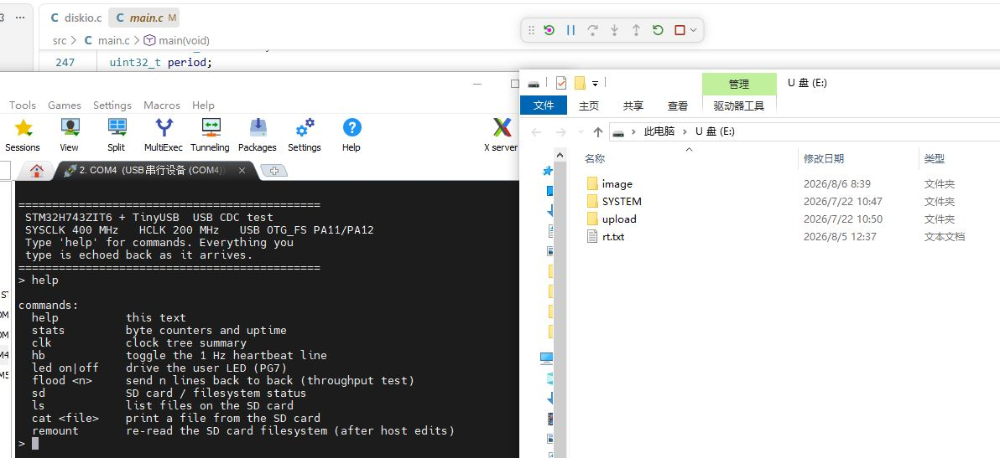

**AI 开发**：项目框架、TinyUSB 移植、复合设备描述符

**个人参与**：仿真环境、提示词

**工作量**：USB 底层驱动 → 移植 TinyUSB 实现 CDC、MSC 应用 → 实现混合设备并完善接口

提示词：[prompter.md](./001.stm32h743_tinyusb_cdc_msc/docs/prompter.md)

#### 002 · 基于 TinyUSB 的 UVC 摄像头（OV5640）

🚀 [002.stm32h743_tinyusb_uvc_ov5640](./002.stm32h743_tinyusb_uvc_ov5640/README.md)

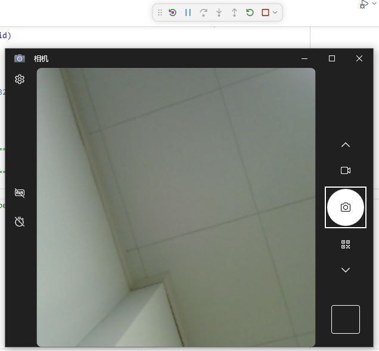

**AI 开发**：项目框架、TinyUSB 移植、UVC 驱动实现
**个人参与**：仿真环境、提示词、OV5640 驱动
**工作量**：集成 OV5640 驱动 → 移植 TinyUSB 实现 UVC 应用 → 摄像头多缓冲采集经 USB 接口提交

提示词：[prompter.md](./002.stm32h743_tinyusb_uvc_ov5640/prompter.md)

#### 003 · LVGL OLED 显示（支持 SD 卡中文字库）

🚀 [003.stm32h743_lvgl_oled](./003.stm32h743_lvgl_oled/docs/README.md)

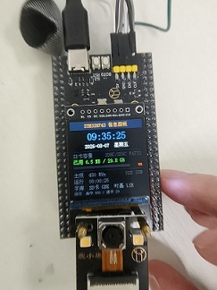

**AI 开发**：项目框架、LVGL 移植、SD 卡 / FatFs 移植

**个人参与**：仿真环境、提示词、OLED 驱动

**工作量**：SD 卡驱动 + FatFs 移植 + 中文字库支持 → 移植 LVGL 并与 SD 卡字库联动 → 实现含中文显示的 LVGL 界面

提示词：[prompter.md](./003.stm32h743_lvgl_oled/docs/prompter.md)

#### 004 · 基于 SD 卡和 OLED 的图片轮播

🚀 [004.stm32h743_sd_oled_img](./004.stm32h743_sd_oled_img/README.md)

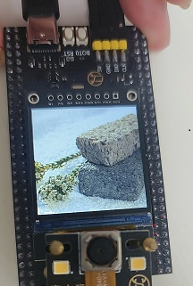

**AI 开发**：项目框架、SD 卡 / FatFs 移植、图片解析库支持

**个人参与**：仿真环境、提示词、OLED 驱动

**工作量**：SD 卡驱动 + FatFs + 图片读取 → 移植 JPEG 解析库得到图像数据 → 显示到界面

提示词：[prompter.md](./004.stm32h743_sd_oled_img/docs/prompter.md)

#### 005 · 基于 CMSIS-NN 的人存在检测（OV5640 + CMSIS-NN）

🚀 [005.stm32h743_person_detect](./005.stm32h743_person_detect/README.md)

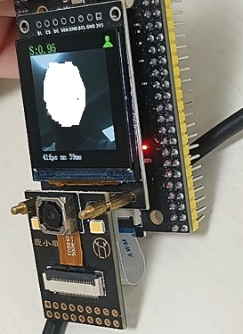

**AI 开发**：项目框架、CMSIS-NN 移植、人检测模型、输出显示

**个人参与**：仿真环境、提示词、OV5640 驱动、OLED 驱动

**工作量**：集成摄像头与显示屏驱动 → 移植 CMSIS-NN 框架并获取人检测模型 → 多缓冲采集经模型处理后将整合数据输出到屏幕

提示词：[prompter.md](./005.stm32h743_person_detect/docs/prompter.md)

#### 006 · 基于 CMSIS-NN 的人脸检测与显示

🚀 [006.stm32h743_face_detect](./006.stm32h743_face_detect/README.md)

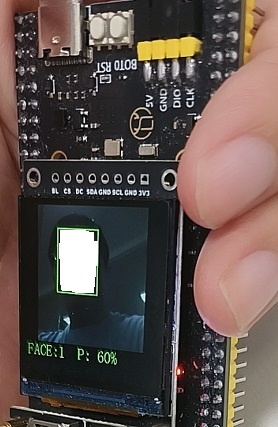

**AI 开发**：项目框架、CMSIS-NN 移植、**人脸检测模型训练与转换**、输出显示

**个人参与**：仿真环境、提示词、摄像头驱动、显示屏驱动

**工作量**：驱动集成 → CMSIS-NN 框架 + 本地 Python 训练的人脸检测模型 → 多缓冲采集经推理后输出到屏幕

> 这个项目端到端只花了约 3 小时。Agent 自己下载图像库、自己写 Python 训练脚本、产出模型、
> 转成 int8 再部署上板——正是这一条闭环，颠覆了我对 Vibe Coding 的认知。

提示词：[prompter.md](./006.stm32h743_face_detect/docs/prompter.md)

#### 007 · 基于 TinyUSB 的 CMSIS-DAP 协议调试器

🚀 [007.stm32h743_cmsis_dap](./007.stm32h743_cmsis_dap/README.md)

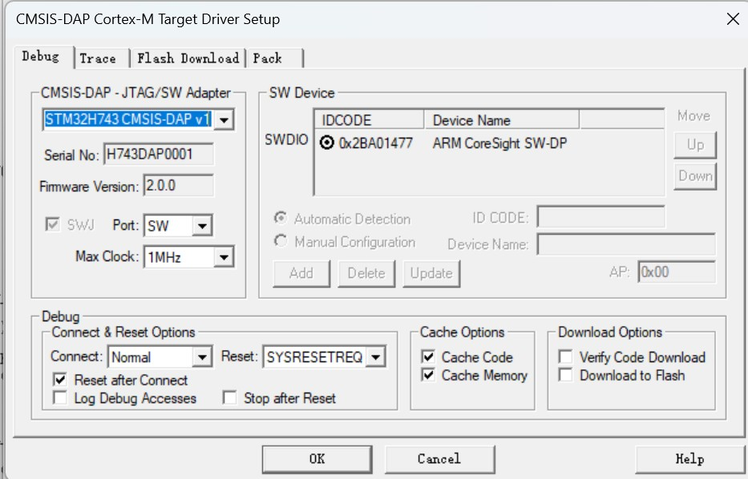

**AI 开发**：项目框架、TinyUSB 移植、CMSIS-DAP 协议支持

**个人参与**：仿真环境、提示词、JTAG/SWD 接口处理（找到 Arm 官方例程）

**工作量**：TinyUSB 移植 → CMSIS-DAP 协议移植支持 → 整合 JTAG/SWD 操作时序，实现完整功能并测试

提示词：[prompter.md](./007.stm32h743_cmsis_dap/docs/prompter.md)

#### 008 · 基于 LVGL 的智能手表应用

🚀 [008.stm32h743_lvgl_mos](./008.stm32h743_lvgl_mos/README.md)

| 时钟 | 相机 |
|---|---|
| 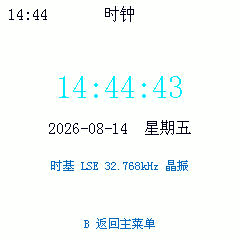 | 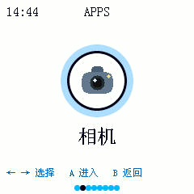 |

| 文本阅读器 | NES 模拟器 |
|---|---|
| 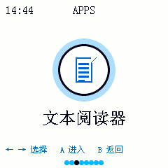 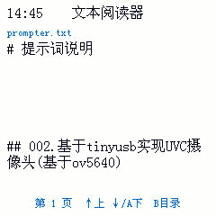 | 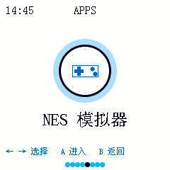 |

**AI 开发**：项目框架、TinyUSB 移植、LVGL 移植、图像库移植、NES 模拟器移植、菜单实现、串口虚拟输入

**个人参与**：仿真环境、提示词、OLED 驱动、OV5640 驱动

**工作量**：摄像头 / 显示屏 / USB / SD 卡底层驱动 → LVGL UI 功能 → NES 模拟器与上位机虚拟键盘 → 相机、图片查看器、文本阅读器

提示词：[prompter.md](./008.stm32h743_lvgl_mos/docs/prompter.md)

#### 009 · 基于 Zephyr 的 LVGL 功能界面

🚀 [009.stm32h743_zephyr](./009.stm32h743_zephyr/README.md)

| LVGL 界面 | Zephyr 命令行 |
|---|---|
| 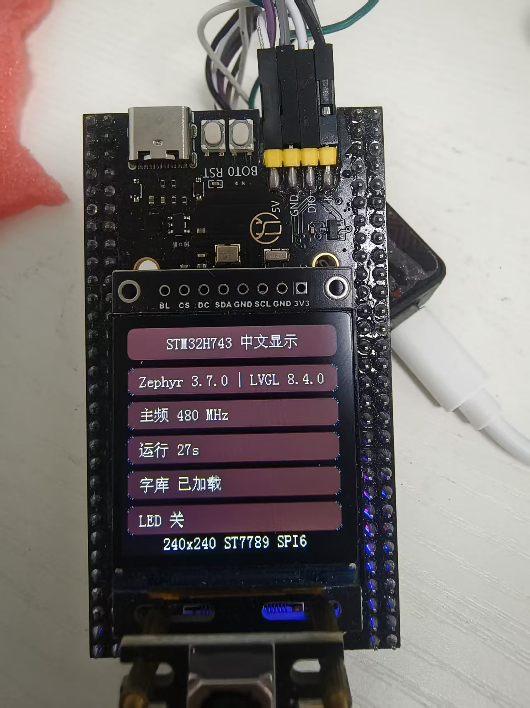 | 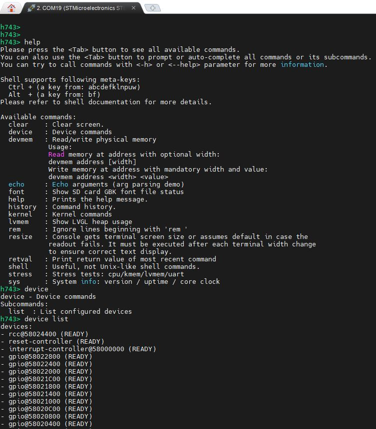 |

**AI 开发**：项目框架、Zephyr 移植、Zephyr 兼容 LVGL 显示、Zephyr 兼容 FatFs、UI 开发、串口指令支持

**个人参与**：仿真环境、提示词、OLED 驱动、功能引导

**工作量**：`nucleo_h743zi` 板级目标、ST7789/SPI6 设备树 overlay、SD 卡字库加载路径

提示词：[prompter.md](./009.stm32h743_zephyr/doc/prompter.md)

#### 010 · 基于 QSPI 虚拟 U 盘与安全升级的 Bootloader

🚀 [010.stm32h743_boot](./010.stm32h743_boot/README.md)

| Boot 跳转 App | 升级后跳转执行 | QSPI 虚拟成 U 盘 |
|---|---|---|
| 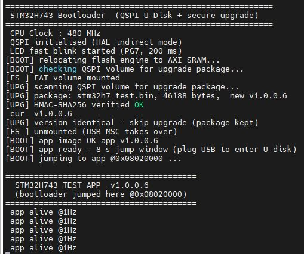 | 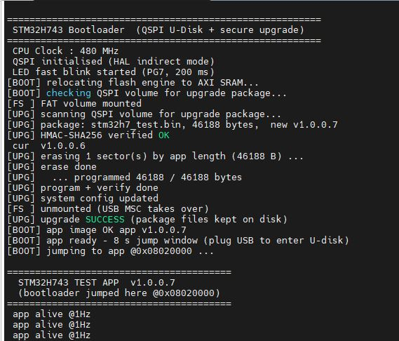 | 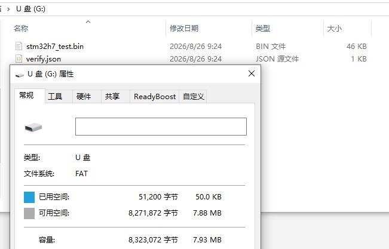 |

**AI 开发**：工程骨架、QSPI FatFs、TinyUSB MSC、HMAC-SHA256 安全升级、固件跳转、OpenOCD + GDB 函数级验证

**个人参与**：仿真环境、提示词、真机验收

**工作量**：Bootloader 对镜像做 HMAC-SHA256 签名校验，经 FatFs 写入 QSPI 后跳转 App

提示词：[prompter.md](./010.stm32h743_boot/docs/prompter.md)

#### 011 · 基于 emWin + FreeRTOS 的 OLED 信息面板

🚀 [011.stm32h743_freertos_emwin](./011.stm32h743_freertos_emwin/README.md)

**AI 开发**：工程骨架、emWin（STemWin）GUI 栈移植、ST7789 SPI6 驱动、SD 卡 GBK 字库、FreeRTOS

**个人参与**：仿真环境、提示词、真机验收

**工作量**：

1. 在 003 LVGL 版基础上用 emWin 重做整套 OLED 信息面板（界面 / 功能 1:1 对齐）
2. 解决 STemWin 预编译库与 binutils 2.44 不兼容（锁定 GNU Arm Embedded 14.2.rel1 工具链）
3. 修复 `GUI_Init` 死循环（CRC 时钟未使能）、ARGB 色序差异、`LCD_*` 符号冲突

#### 012 · 基于 USB CDC 与 UART4 的高可靠双向串口桥接

🚀 [012.stm32h743_usb_serial](./012.stm32h743_usb_serial/README.md)

**AI 开发**：桥接架构、环形缓冲、USB CDC 描述符与调度、流控自管理、PC 侧压测 / 延迟工具

**个人参与**：仿真环境、提示词、真机压测验收

**工作量**：

1. 无 RTOS 下实现 USB CDC ACM ↔ UART4 双方向透明转发（D-Cache 保持开启，**不使用 MPU 划区**）
2. 修复环形缓冲满 / 空二义性导致的数据覆盖（保留 1 字节不用）
3. 修复 7 数据位 + 校验时校验位污染数据字节（按数据位掩码就地掩蔽）
4. 修复 RTS 配成复用模式却未启用 `HwFlowCtl` 导致的引脚悬空、流控失效
5. 定位并排除主机侧读数方式造成的 34 ms "假延迟"（`read(in_waiting or 4096)`）
6. PA0/PA1 短接自回环 + Python 一键自动化压测 / 延迟 / 流控 / 7bit 校验回归

#### 013 · 软件 UART（GPIO + Timer + DMA）

🚀 [013.stm32h743_virtual_uart](./013.stm32h743_virtual_uart/README.md)

**AI 开发**：软件 UART 收发栈、DMA 链、RX 起始位检测与帧校验、echo 主循环、压力测试脚本

**个人参与**：仿真环境、提示词、引脚级实测

**工作量**：

1. **只用** GPIO + Timer + DMA + EXTI 产生和解析真实 UART 波形，**完全不使用 USART 外设**
2. TX 走定时器触发 DMA 写 `GPIOx->BSRR`，并在引脚上实测位周期
3. RX 起始位检测、位中点采样与帧校验（起始 / 停止 / 校验错误计数）
4. 两套构建后端保持同步：**GCC**（arm-none-eabi 15.3.1 + CMake + Ninja）与 **Keil MDK**（ARMCLANG 6.14）
5. 验收：10 万字节往返、全部缓冲边界尺寸、**1800 s 连续全双工长稳**
   （1,728,000 / 1,728,000 B，0 处不匹配，恰好 960 B/s = 9600/10），外加错误波特率注入
   → **24/24 全过**

### STM32F429IGT6

#### 101 · 基于 lwIP 的局域网管理系统

🚀 [101.stm32f429_net](./101.stm32f429_net/README.md)

| HTTP | HTTPS |
|---|---|
| 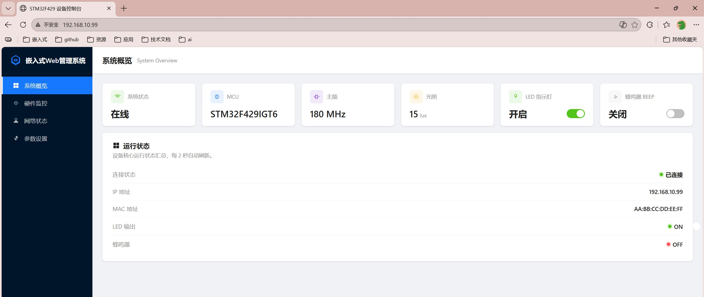 | 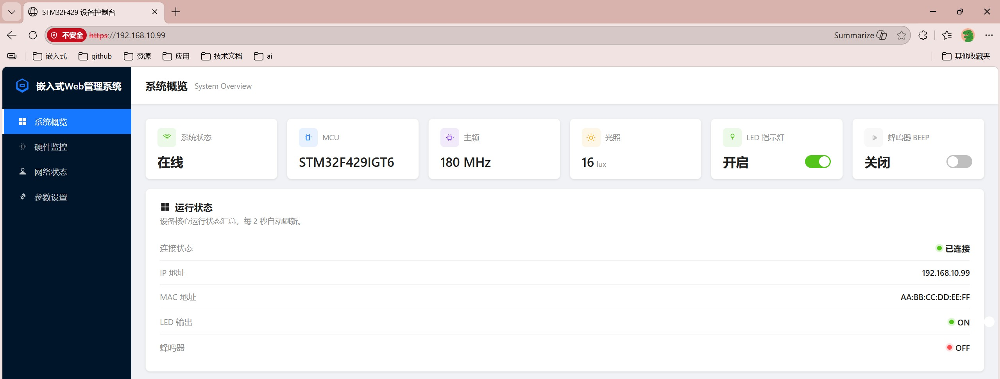 |

| 串口 shell | Telnet shell | SNMP 代理 + 客户端 |
|---|---|---|
| 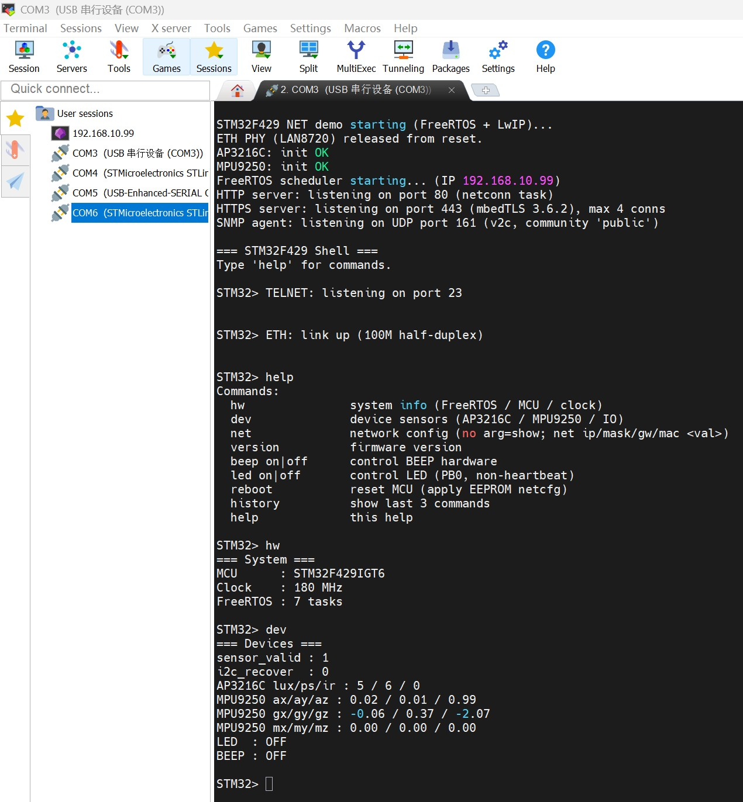 | 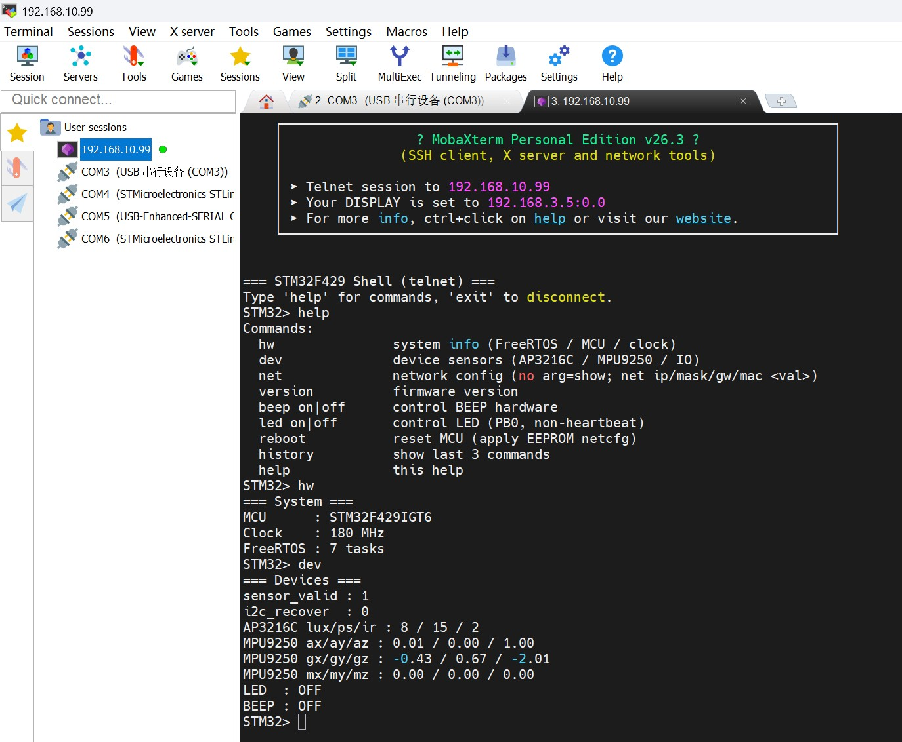 | 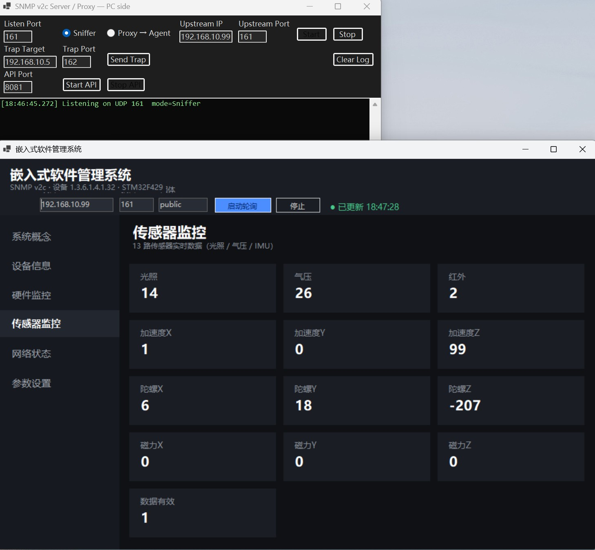 |

**AI 开发**：项目框架、网口驱动、FreeRTOS 移植、lwIP 移植、HTTP/HTTPS 服务、Web 网页、串口 shell、telnet 服务、SNMP 服务与代理 / 客户端

**个人参与**：仿真环境、提示词、基础驱动、功能引导

**工作量**：LAN8720A（RMII，PHY addr 0）+ `ETH_RESET` 经 PCF8574T（P7）控制，SDRAM承载FreeRTOS + lwIP，双栈 HTTP/HTTPS（自签证书）与四套独立管理接口。
HAL timebase 由 SysTick 改为 TIM7，规避 FreeRTOS 冲突。

提示词：[prompter.md](./101.stm32f429_net/prompter.md)

#### 102 · 基于 USB Host（U 盘）+ exFAT + LVGL + GT911 触摸的综合面板

🚀 [102.stm32f429_tinyusb_ui](./102.stm32f429_tinyusb_ui/README.md)

**AI 开发**：工程骨架、TinyUSB USB Host（MSC）、FatFs exFAT、LVGL、GT911/GT9147 软件 I²C 触摸、FreeRTOS + SDRAM、`PRINT_LOG` 日志系统

**个人参与**：仿真环境、提示词、真机验收

**工作量**：

1. F429 上跑 TinyUSB 主机栈读 U 盘（**真 exFAT 支持，非 FAT32 伪装**）
2. LVGL + 800×480 FMC 8080 LCD + GBK 字库（SD / U 盘双来源，启动加载器回退）
3. GT911 触摸中断链路 + 中断风暴三层防护 + I²C 总线恢复

### ESP32-S3

#### 201 · N16R8 FreeRTOS 多任务设备监控器

🚀 [201.esp32s3_rtos](./201.esp32s3_rtos/README.md)

**AI 开发**：FreeRTOS 多任务骨架（任务 / 队列 / 信号量 / 互斥量 / 软件定时器）、ESP32-S3 Arduino Core

**个人参与**：仿真环境、提示词

**工作量**：建立可复用的 FreeRTOS 基础工程（`config.h` 集中 GPIO / 参数，**不猜测引脚**），4 任务 + 1 软件定时器构成设备监控器，UART 命令查看 / 控制。
零警告构建 + CH343 串口下载 + 双核信息 / 任务表验收。

#### 202 · USB 远程硬件仿真器

🚀 [202.esp32s3_hw_detect](./202.esp32s3_hw_detect/README.md)

**AI 开发**：模块化事件总线、UART/ADC/GPIO 监视器、Wi-Fi STA+AP、MQTT、Web + WebSocket 界面、OTA、配置持久化

**个人参与**：仿真环境、提示词、硬件约束确认

**工作量**：把 ESP32-S3 变成**网络化硬件调试网关**，将目标 MCU 的 UART 日志、外部 ADC 电压（ADS1115，未接时回退内部 ADC）与 GPIO 状态暴露给浏览器、上位机与未来的 AI Agent。

GPIO48（板载 WS2812B）由专用 LED 控制器独占，GPIO19/20（USB D-/D+）永久保留，禁止被通用 GPIO 占用。

另见：[`user_document.md`](./202.esp32s3_hw_detect/user_document.md) · [`DELIVERY.md`](./202.esp32s3_hw_detect/DELIVERY.md) · [prompter.md](./202.esp32s3_hw_detect/prompter.md)

#### 203 · CMSIS-DAP 无线调试探针

🚀 [203.esp32s3_wireless_debug](./203.esp32s3_wireless_debug/README.md)

**AI 开发**：CMSIS-DAP v1 命令处理、SWD/JTAG 位带引擎、调试引擎、Wi-Fi 传输层、OpenOCD 探针配置

**个人参与**：仿真环境、提示词、真机对接目标板验收

**工作量**：

1. TinyUSB HID 实现 CMSIS-DAP v1（HID 单通道，固定 VID/PID），同时支持 SWD 与 JTAG
2. 性能优化：CPU 240 MHz + 热点代码 `IRAM_ATTR` + GPIO 驱动强度拉满 + 热路径日志降级，时钟上限提升至 8 MHz
3. USB / Wi-Fi 传输仲裁（互斥），用 `tud_mounted()` 判定主机存在；无 USB 主机时启动 SoftAP 兜底
4. 修复 JTAG `Invalid ACK (4)` FAULT（`bool` 形参提升导致 TDI 恒高）+ 校正 Shift-IR 末位时序
5. PSRAM 静态保留池与 Wi-Fi 缓冲收紧，为 DAP-over-WiFi 预留内存

#### 204 · 触摸电子书 / 多功能设备

🚀 [204.esp32s3_touch_ebook](./204.esp32s3_touch_ebook/README.md)

**AI 开发**：完整 LVGL 9 应用、10 个产品页、GBK 点阵阅读器、屏幕与触摸点亮

**个人参与**：仿真环境、提示词、面板原理图分析、真机验收

**工作量**：在微雪 ESP32-S3-Touch-LCD-4.3B（800×480 RGB，电容触摸）上从零搭建电子书 / 工具类 UI。

页面族：主页、阅读器、文件管理、相册、笔记、绘图、时钟、日历、天气、设置，外加显示测试与触摸测试
两个验收页。页面集**已封闭**——不在列表内的页面即视为回归。

阅读器使用 SD 卡上的经典 HZK 风格 GBK 点阵字库（12/16/24/32），其 23940 码位索引与旧 `gbk_table` **并不一致**。

提示词：[prompter-step1.md](./204.esp32s3_touch_ebook/doc/prompter-step1.md) · 计划：[plan-4reqs.md](./204.esp32s3_touch_ebook/doc/plan-4reqs.md)

### Renesas RA8D1

#### 301 · RA8D1 Vision Board + LVGL

🚀 [301.ra8d1_lcd_lvgl](./301.ra8d1_lcd_lvgl/README.md)

**技术栈**：RT-Thread Nano 5.0.2 + LVGL v9.1.0 + Arm GNU GCC 15.3.1 + CMake/Ninja + OpenOCD/pyOCD

**AI 开发**：板级点亮、FSP 集成、GLCDC/MIPI-DSI 通路、LVGL 移植、RTC 驱动、启动动作条、阶段验收脚本

**个人参与**：仿真环境、提示词、探针配置

**工作量（Phase 0 → 8 全部 ✅）**：
- Phase 0.5/0.6 —— GCC 裸机最小工程 + 可用的 OpenOCD + pyOCD 调试链
  （DFP pack target 在 ART-Link 上 init 失败；`target_override: cortex_m` + FLM 注入可用）
- Phase 1 —— RT-Thread Nano + LED + SCI9 控制台 shell（`led on|off|blink`），15/15 通过
- Phase 2–4 —— GLCDC LCD、CEU 摄像头、LVGL v9.1.0 跑在帧缓冲上，7/7 通过
- Phase 5–6 —— 实物 480×360 MIPI 面板不匹配 RGB666 并口路径，改为 GLCDC → DSI 桥接点亮；
  CST812T 触摸在寄存器层经 SWD 逐项取证正确，但**控制器不响应任何 I²C 事务** → 判定面板 / 硬件层故障
- Phase 7 —— 整体移除触摸，收敛为单页遥测界面 + 硬件 RTC。
  发现大坑：`RCR4.RCKSEL` 语义与字面**相反**（`0 = 子时钟`、`1 = LOCO`），配错会让时钟**快 10.63 倍**
- Phase 8 —— 用真实启动动作条替换复位时的冻结彩条；启动帧靠 SWD 复位后 0.55 s 立刻 halt 抓取

#### 302 · RA8D1 NES 模拟器

🚀 [302.ra8d1_lcd_nes](./302.ra8d1_lcd_nes/)

**技术栈**：RT-Thread Nano + Dave2D（DRW2D GPU）+ W25Q64 FatFs + TinyUSB MSC

**工作量**：

在 RA8D1 Vision Board 上跑 NES 模拟器，贴图走 GPU 加速；
ROM 存放于板载 W25Q64 QSPI Flash 并挂成 FAT 卷，再经 USB MSC 暴露给主机成盘。

验收脚本覆盖 GPU 贴图路径、逐帧输出、ROM 完整性与状态区行为。

> ⚠️ `CMakeLists.txt` 中已记录已知问题：`-O1`/`-O2` 会破坏串口控制台（格式化输出在行中被截断），
> 因此项目锁定了优化等级。

---

## 技能库

这 22 个项目里踩过的坑，全部提炼进了一个独立、可复用的仓库：

### 👉 [zc110747/EmbedSkills](https://github.com/zc110747/EmbedSkills)

> **25 个 skill · 91 篇 references** —— 全部写成 `agent_created: true` 的 Agent Skill，
> Agent 遇到对应问题时会**自动加载**。

这是整个系列最有价值的产出。与其把经验写进没人看的 README，不如把它变成 Agent 能直接执行的判据。
每条经验要进仓，必须满足三条准入门槛：

| 门槛 | 说明 |
|---|---|
| **可判据** | 能写成「满足 X 则 Y」的规则，而非故事 |
| **可复现** | 换项目、换板子仍成立，或明确标注适用芯片 |
| **有出处** | 引脚、寄存器、时钟、型号都核对过；未核对的显式标注 |

三层加载模型是它省 token 的关键：只有 `name` + `description` 常驻（全会话约 3 KB）；
`SKILL.md` 正文在触发词命中时加载；`references/*.md` 只在正文指向时才读。

| 领域 | Skill |
|---|---|
| **MCU / 嵌入式（10）** | `mcu-ai-agent-workflow` · `embedded-windows-toolchain` · `stm32-build-and-scaffold` · `stm32-peripherals-and-memory` · `mcu-debug-forensics` · `embedded-verification-acceptance` · `mcu-logging` · `mcu-code-style` · `mcu-cpp-development` · `embedded-config-portal` |
| **显示 / GUI（1）** | `lvgl-font-and-render` |
| **平台移植（2）** | `zephyr-stm32-porting` · `esp32-platform-notes` |
| **机器人 / 多物理场（3）** | `truth-source-and-model-vendoring` · `robotics-mechanism-and-sim` · `robotics-link-diagnostics` |
| **SOC / 视频 / 边端 AI（1）** | `soc-video-and-edge-ai` |
| **前端取证（1）** | `web-headless-verification` |
| **工具类（2）** | `schematic-pdf-netlist` · `mail-weekly-digest` |
| **逆向复刻（4）** | `replica-recon` · `replica-memory-engine` · `replica-ui-fidelity` · `replica-mock-harness` |
| **代码规范落地（1）** | `mcu-code-style-apply` |

### 安装

```bash
git clone https://github.com/zc110747/EmbedSkills.git
cd EmbedSkills

# 单个安装
cp -r stm32-build-and-scaffold ~/.workbuddy/skills/

# 全量安装
for d in */; do
  [ -f "$d/SKILL.md" ] && cp -r "$d" ~/.workbuddy/skills/
done
```

安装后**新开会话**生效。请连整个目录一起复制（含 `references/`、`scripts/`）——
只复制 `SKILL.md` 会让正文里所有「详见 references/…」指向空文件。

> 全局 `~/.workbuddy/skills/` 是**唯一权威副本**，各工程直接使用全局 skills。
> 镜像用 `EmbedSkills/sync_skills.sh` 维护（`--check` / `--prune` / `--restore` / `--list`）。

---

## 验收优先工作流

AI 做完的项目，只有在**真机上被证明**才算完成。本系列贯彻的节奏：

```text
出实现计划  →  确认  →  实现  →  Debug + Release 双构零警告
           →  烧录  →  串口 / 真机验证
           →  扩展一次性 tools/verify_*.py（给出 PASS / FAIL 计数）
           →  交付清单
```

每个项目都带一套 `tools/verify_*.py`，一次跑完整套并打印 pass/fail 计数。
这不是走形式——它专门用来抓「编译通过但硬件悄悄什么都没干」这类问题：

| 项目 | 验收脚本 | 结果 |
|---|---|---|
| 013 | `tools/verify_stress.py` | 24/24 通过 —— 1800 s 全双工长稳，恰好 960 B/s |
| 301 | `tools/verify/verify_phase8.py` | 10 passed / 0 failed / 2 manual —— SWD 帧缓冲像素断言 |
| 302 | `tools/verify/verify_nes_frame.py` | 逐帧 NES 输出与 GPU 贴图路径 |
| 012 | PC 侧压测 + 延迟 + 流控 + 7bit 校验 | Python 一键回归 |

让它成立的三条规矩：

1. **断言落在物理结果上，而不是 API 的返回值上。** 「LED 驱动返回了 `HAL_OK`」什么也证明不了；
   经 SWD 读回 `PODR` 才证明得了。
2. **把「环境缺失」和「引入回归」分开报。** `third_party/` 被 gitignore 导致的失败单独标注，
   真实的破坏永远不会藏在它后面。
3. **探针代码绝不允许进交付固件。** 会灌合成数据的取证代码，验证完必须移出。

---

## 提示词四要素

每个项目都留有产出它的原始提示词（`prompter.md`）。行之有效的结构：

| 要素 | 内容 |
|---|---|
| **功能需求** | 这个东西做什么，用可观测的行为描述 |
| **硬件信息** | MCU、引脚、外设、时钟、型号——明确给出，绝不留给 AI 猜 |
| **开发步骤** | 分阶段、有顺序，让 AI 永远有下一个明确的动作 |
| **验证手段** | 每个阶段用什么证明自己（串口输出、SWD 读回、实测） |

> 不要让 AI 直接开发一个结果。给出**建议、步骤和目标**，它才能自己把路走完。

---

## 开发经验总结

完成所有这些项目，加上调试整理，单个项目大概 1–2 天完成。

其中让我印象最深的是人脸检测项目，大概花了 3 个小时就搞定了。在执行过程中，它还下载了图像库，
自己编写 Python 训练了个模型——这颠覆了我对 Vibe Coding 的认知。AI 的上限实在太高了：
这种项目如果让我来做，从可行性、驱动移植编写、模型训练、嵌入式端移植，再整合输出、调试完整，
整个需求至少需要几周时间。

但与此同时，AI 的下限也很低。调试 CMOS、OLED 模块时，因为生成的参数配置错误，卡住一个小时也没有解决；
有个 CMake 文件的链接遗漏，导致未链接到正常的入口，启动卡在循环里，花费半小时也没解决。
不过这些在提供我已经完善的驱动之后，以及手动参与部分修改之后，就顺利实现了项目。

在开发这些项目时，总结的经验如下：

🏷️ **在提需求时，要对项目有清晰的认知**
包括功能需求、硬件信息、开发步骤和验证手段。不要让 AI 直接开发一个结果，
而是给出建议、步骤和目标，让 AI 有步骤可行。

🏷️ **已有硬件、驱动资源，可以尽可能提供**
对于简单的驱动，如 RTC、GPIO、I2C 内部模块完全没有难度；但是对于外部器件（如 LCD、CMOS 等），
如果一次成功还可以，不成功则重复调试很久都不会成功。调试过的硬件，提供源码比直接生成稳定得多，
效率会更高。

🏷️ **提供完整的单片机开发仿真环境**
实现代码才是第一步。无法验证的代码生成后，再去开发调试还要去理解，花费精力并不少。
让 AI 跑通流程是能够迭代的基础。

🏷️ **需要及时的人工干预**
嵌入式需要交叉编译和远程仿真，如果断开或者设备异常，就完全堵塞执行流程。
在实现 USB 项目时，就因为未重新枚举，卡住执行半个小时。这就需要及时的外部干预。

---

## 使用 Vibe Coding 感触

Vibe Coding 真的颠覆了我的认知。点亮个 LED、调试电机、读取传感器，这种实现对于我这种熟练工
并没有吸引力。

不过实现这种我个人能力边界外——知道怎么做，但是苦于没有精力去补足知识点、需要大量时间精力的
项目，吸引力就太大了。虽然不想承认，但掌握 AI 开发流程，其能力上限远超过去的我。
抗拒只能被淘汰，我也只能努力接受，迭代自身能力，加入到日常的工作流程中。

---

## 仓库结构

```text
MCU-Agent/
├── 001..013.*/              STM32H743ZIT6 项目
├── 101..102.*/              STM32F429IGT6 项目
├── 201..204.*/              ESP32-S3 项目
├── 301..302.*/              Renesas RA8D1 项目
│   ├── app|applications/    应用层
│   ├── bsp/                 板级适配层
│   ├── Drivers/             厂商 HAL（gitignore，来自 support_tools/）
│   ├── third_party/         上游第三方库（gitignore，来自 support_tools/）
│   ├── tools/verify/        一次性验收脚本
│   ├── .vscode/             configure / build / clean / flash + cortex-debug
│   └── README.md            单项目细节
├── document/
│   ├── support.md           环境搭建说明
│   ├── image/               本 README 使用的截图
│   ├── stm32h743/            原理图 + 硬件说明
│   ├── stm32f429/            原理图 + 硬件说明
│   └── esp32s3/              原理图 + 硬件说明
├── support_tools/           共享 Drivers/third_party 压缩包 + SD 卡内容
├── project.list             项目索引
├── vscode_unify_convention.md   多工程统一 .vscode 规范
└── LICENSE                  MIT
```

单项目依赖方向是严格的：`applications → bsp → {Drivers, third_party}`，禁止反向。

**统一 `.vscode` 规范**（三条铁律，详见 [vscode_unify_convention.md](./vscode_unify_convention.md)）：

1. 工具一律写**裸程序名**，必须走系统 PATH，禁止硬编码安装路径。
2. `tasks.json` 只保留 **4 个任务**：`configure` / `build` / `clean` / `flash`。
3. `openocd.cfg` 与 `*.svd` 放**工程根目录**，不再需要 `openocd/` 子目录。

---

## 规划

- [x] 001–013、101–102、201–204、301–302 —— 22 个项目全部完成并通过真机验证
- [x] 25 个 skill 发布至 [EmbedSkills](https://github.com/zc110747/EmbedSkills)
- [x] README 双语化 —— 英文（默认）+ 简体中文
- [ ] skill 仓库的 CI 一致性校验

---

## License

[MIT](./LICENSE) © 2026 听心跳的声音

<sub>本仓库各项目由 AI Agent 协作完成；每个项目目录都记录了哪些部分由 AI 生成、哪些需要人工介入。</sub>
